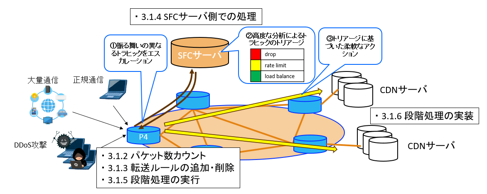
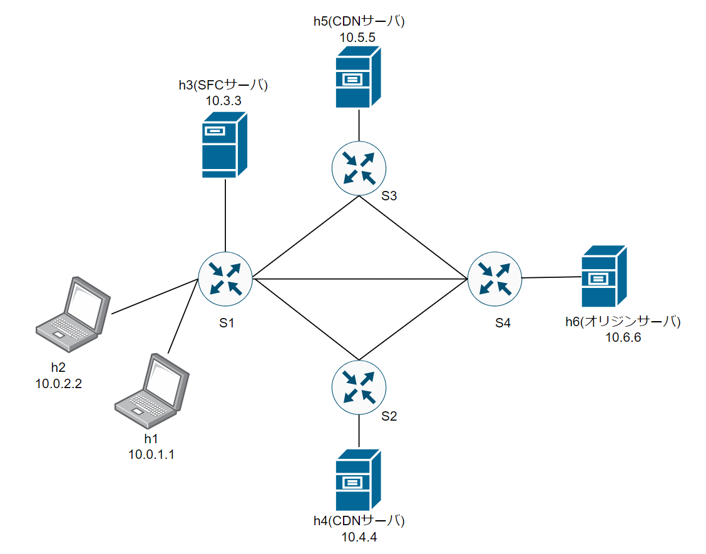
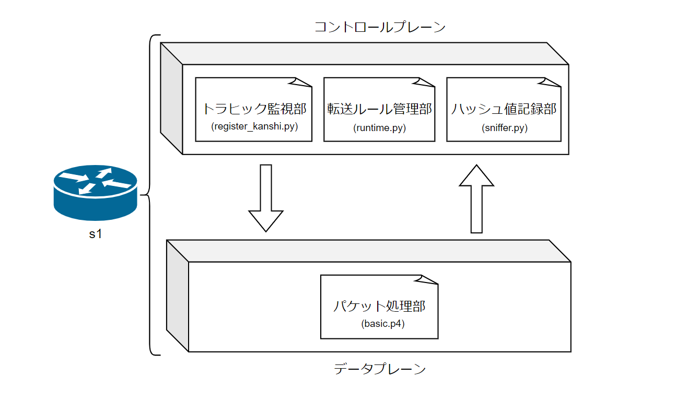
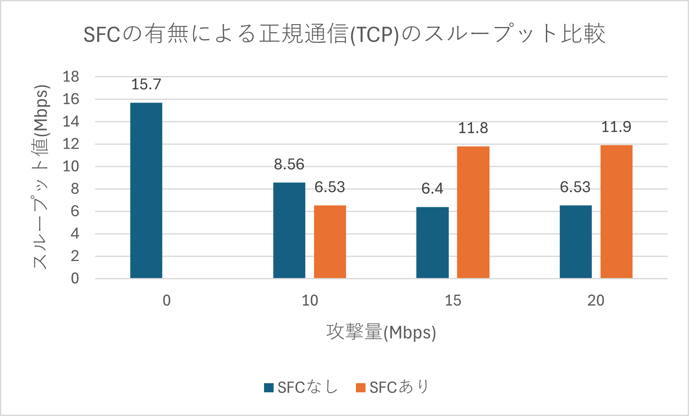
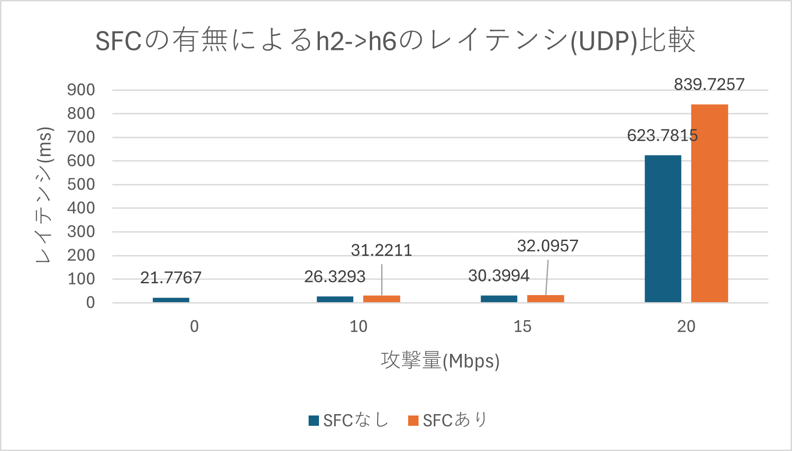
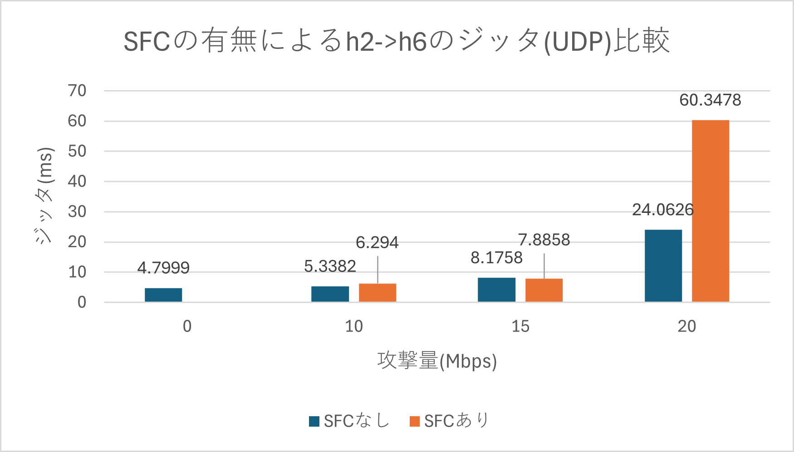

# P4とSFCの動的連携による攻撃トラヒックの段階的緩和

*Dynamic and Gradual Mitigation of Attack Traffic Using P4 and SFC Coordination*

成蹊大学理工学部 情報通信ネットワーク研究室 2025年度卒業論文の実装・実験コードです。
論文: [bachelor-lua / Sotsuron.pdf](https://github.com/yahato2474/bachelor-lua) (LaTeX ソースは `Sotsuron.tex`)

## 概要



DDoS攻撃などの攻撃トラヒックを、守りたいサーバの手前で一律に遮断するのではなく、**ネットワークの入口にある P4 スイッチと SFC サーバを連携させ、トラヒック量に応じて段階的に緩和**します。

- P4 スイッチ (s1) が **送信元 IP ごとのパケット数**をレジスタでカウントする。
- コントロールプレーンが閾値超過を検知すると、**該当送信元のパケットだけ**を SFC サーバ (h3) へ転送するルールを P4Runtime で動的に追加する。閾値を下回れば削除する。
- SFC サーバが流量 (Mbps) を測り、処理レベルを IPv4 ヘッダの **ECN 領域 (TOS 下位 2bit)** に書き込んでスイッチへ返す。
- スイッチはその値に従って処理する。

| ECN 値 | レベル | 処理 |
|---|---|---|
| `00` | 通常 | 通常の IPv4 転送 (正規通信はここ) |
| `01` | ロードバランス | 送信元 IP のハッシュで CDN サーバ (h4 / h5) に振り分け |
| `10` | レート制限 | P4 の meter で超過分を破棄し、残りは LB と同じ宛先へ |
| `11` | Drop | SFC サーバ側で破棄 (スイッチの負荷と帯域を節約するため) |

2bit で 4 状態を表すのは実装上の都合で、概念としては処理の種類を 4 つに限定していません (論文 3.1.1)。

## 構成

```
 h1 (攻撃者) ──┐                    ┌── s2 ── h4 (CDN)
 h2 (正規利用者)─┼── s1 (P4) ────────┼── s3 ── h5 (CDN)
 h3 (SFCサーバ)─┘                    └── s4 ── h6 (オリジンサーバ)
                                           (s2-s4, s3-s4 も接続)
```

| ホスト | IP | 役割 |
|---|---|---|
| h1 | 10.0.1.1 | 攻撃者 (UDP flood を h6 へ) |
| h2 | 10.0.2.2 | 正規利用者 (測定用。監視対象から除外) |
| h3 | 10.0.3.3 | SFC サーバ (監視対象から除外) |
| h4 / h5 | 10.0.4.4 / 10.0.5.5 | CDN サーバ (LB の転送先) |
| h6 | 10.0.6.6 | オリジンサーバ (保護対象) |

s1 が P4 スイッチ、s2〜s4 は単純な IPv4 転送です。実験は Oracle VM VirtualBox 上の [p4-tutorials-vm](https://github.com/YitaoYuan/p4-tutorials-vm) (BMv2) で行っています。



### 動作の流れ

1. s1 が送信元 IP の CRC32 から `index` (0〜1023) を求め、`packet_counter[index]` を加算する。
2. **トラヒック監視部**が `simple_switch_CLI` で 1 秒ごとにレジスタを読み、増分から Mbps を算出する (P4Runtime ではレジスタを直接読めないため CLI を使用)。
   $R = \Delta P \times S_{pkt} \times 8 / (\Delta t \times 10^6)$、ただし $S_{pkt}$ は iperf の MTU に合わせて **1500 Byte** としている。
3. 8 Mbps 以上で**転送ルール管理部**が `redirect_table` に (送信元, 宛先, `packet_level=0`) → h3 のエントリを追加し、あわせて meter を設定する。6 Mbps を下回ったら削除する。閾値を 2 つにしたのは、仮想環境でトラヒックが揺らぐため追加・削除が頻発するのを防ぐためである。
4. h3 が直近 1 秒の受信量から Mbps を求めて ECN を書き換え、宛先を LB 先に書き換えて s1 へ返す。
5. s1 が `packet_level` に従って処理する。

レジスタ index から送信元 IP は逆算できないので、**ハッシュ値記録部**が通過パケットを見て `index,src,dst` を `./tmp/hosts_test.txt` に記録し、ルール操作時に参照します。

## 論文の機能名とファイルの対応



論文中の名前と、このリポジトリのファイル名は一致しません。以下はコードの内容から対応づけたものです (**ファイル名の対応は推測**を含みます)。

| 論文での名称 | このリポジトリ | 備考 |
|---|---|---|
| パケット処理部 (`switch.p4`) | `basic.p4` | データプレーン本体 |
| トラヒック監視部 (`register_kanshi.py`) | `monitor_mbps.py` | 8 / 6 Mbps のヒステリシス、h2・h3 を除外 |
| 転送ルール管理部 (`runtime.py`) | `runtime_test.py` | `<index> <level>` で追加/変更、`0` で削除。meter 設定も行う |
| ハッシュ値記録部 (`sniffer.py`) | `sniffer_test.py` | 送信元 IP のみで CRC32 (`basic.p4` と一致) |
| SFC サーバ | `SFCserver_test_.py` | Raw socket 実装、Drop は `continue` で再送しない。※論文は RL 8 / Drop 10 Mbps、このファイルは 20 / 20 Mbps で値が異なる |

## 実験結果の要点 (論文第4章)

攻撃は h1→h6 の iperf (10 / 15 / 20 Mbps)、正規通信は h2→h6、測定は 60 秒。

- **攻撃トラヒックの抑制**: h6 に届く攻撃トラヒックは 10 / 15 / 20 Mbps のとき従来手法 10.5 / 15.7 / 21.0 Mbps に対し提案手法 261 / 241 / 541 kbps。攻撃トラヒックのパケットロス率は 97〜98 %。
- **正規通信 (TCP) のスループット**: 攻撃 15 / 20 Mbps では提案手法 11.8 / 11.9 Mbps、従来手法 6.4 / 6.53 Mbps。一方、攻撃 10 Mbps では提案手法 6.53 Mbps が従来手法 8.56 Mbps を**下回る**。LB・RL・Drop が断続的に切り替わり、攻撃が h3 経由の迂回路を通るためと論文は考察している。


- **正規通信 (UDP) の遅延・ジッタ**: 提案手法は増加する。攻撃 20 Mbps ではジッタが約 60.3 ms (従来 約 24.1 ms)。可用性 (スループット維持) と引き換えの遅延として論文は議論している。



- **パケットロス率**: 正規通信は提案・従来とも 0 %。
- **偽陽性**: 攻撃中に h2 のパケットが h3 に転送されることはなかった。ただしこれは h1 と h2 のハッシュ値が衝突しなかったためで、原理的には衝突時に偽陽性が起こり得る。
- 予備実験のベースライン: 攻撃なしの TCP は約 15.7 Mbps、経路が 2 本あるときは約 7.85 Mbps (転送閾値 8 Mbps の根拠)。

### 論文が挙げる限界と今後の課題
- 判定がパケット数・流量のみ。パケットの特徴量を使う高度な判定が必要。
- ハッシュ衝突への対策は未実装 (小規模ネットワーク前提)。
- 仮想環境の単一リソース上での評価。大規模化・物理環境での検証が必要。
- レート制限は、リソースの制約から超過分を破棄している。バッファリングして放出する方式などが候補。

## ディレクトリ構成

| パス | 内容 |
|---|---|
| `basic.p4`, `topology.json`, `s*-runtime.json`, `Makefile` | P4 プログラム、トポロジ、各スイッチの初期テーブル (p4lang/tutorials 形式) |
| `monitor_mbps.py`, `runtime_test.py`, `sniffer_test.py` | 制御プレーン (上表) |
| `SFCserver_test_.py`, `SFCserver_test.py`, `SFCserver.py` | SFC サーバ。`SFCserver_test.py` は閾値 999 Mbps (LB のみ・SNAT あり) の LB 検証用らしく、Drop 処理を持たない。`SFCserver.py` は Scapy・パケット数ベースの初期版 |
| `send_fast_udp.py`, `send_fast.py`, `send.py`, `receive*.py` | トラヒック生成・受信確認 |
| `measure_send.py`, `measure_recv.py` | UDP 遅延・ジッタ・ロス率の測定 (論文 4.2.4〜4.2.6) |
| `h1_throughput`, `h2_throughput`, `rtt`, `packet_loss`, `perf` | iperf / ping による測定スクリプト |
| `result/`, `result_h1/`, `result_h2/`, `latency/`, `*.csv` | 測定結果 CSV |
| `meter.py`, `del` | 補助スクリプト (`del` はパスが固定) |

### 旧版と思われるファイル
次は現在の `basic.p4` と整合しないため、そのままでは動きません。
- `monitor.py`, `monitor_test.py`: 存在しないレジスタ `MyIngress.test_counter` を読む (現行は `packet_counter`)。
- `sniffer.py`: 送信元+宛先でハッシュする (現行は送信元のみで index が合わない)。
- `runtime.py`: `runtime_test.py` と同一内容。

## 実行手順

p4lang/tutorials の演習ディレクトリ (`exercises/<名前>/`) に置く前提です。`Makefile` が `../../utils/Makefile` を、`runtime_test.py` が `../../utils/` の `p4runtime_lib` を使います。

```bash
make run      # ビルド (build/ pcaps/ logs/ を作成) して Mininet 起動
make stop     # 終了 (make clean で生成物も削除)
```

Mininet 起動後、別ターミナルで次を実行します。

```bash
python3 sniffer_test.py        # s1 側 (ホスト OS): index と IP の対応を ./tmp/hosts_test.txt に記録
python3 monitor_mbps.py        # s1 側 (ホスト OS): 監視。閾値超過で runtime_test.py を自動実行

# h3: SFC サーバ
python3 SFCserver_test_.py

# h6: iperf サーバ
iperf -s

# h1: 攻撃トラヒック (iperf, 例: UDP 15 Mbps)
iperf -c 10.0.6.6 -u -b 15M -t 60
# h2: 正規通信の測定
./h2_throughput
```

`monitor_mbps.py` は `hosts_test.txt` を参照するため、**先に `sniffer_test.py` を起動して対象の通信を一度流し、index を登録しておく**必要があります。

## 注意点

- **値が論文と違う箇所**
  - `runtime_test.py` の meter は `METER_RATE = 1` (コメントに旧値 660)。論文は 667 pps (8 Mbps ÷ (1500 Byte × 8)) としている。
  - SFC サーバの閾値は、上表のとおりファイルごとに異なる。
  
  実験の再現には、論文に合わせて値を調整してください。
- **1500 Byte の仮定**: Mbps への換算は 1 パケット 1500 Byte が前提です。違うサイズで流すと、換算値は比例してずれます。
- **ハッシュ衝突**: index は 1024 個のため、別の送信元が同じ index に衝突すると、正規ユーザが攻撃者と誤認されます。
- BMv2 は性能変動が大きく、論文の結果はホストマシン (Core i7-1195G7 / 16 GB) 上の VirtualBox 環境のものです。

## 参考文献
- 西島 崇雄, 「P4を用いたDDoS攻撃の緩和に関する研究」, 2024年度成蹊大学大学院理工学研究科修士論文, 2025.
- C. Garzón et al., "P4 Cybersecurity Solutions: Taxonomy and Open Challenges," IEEE Access, vol. 12, 2023.
- A. Febro et al., "Distributed SIP DDoS Defense with P4," IEEE WCNC, 2019.
- J. Heinanen and R. Guerin, "A Two Rate Three Color Marker," RFC 2698, 1999.
- [p4lang/tutorials](https://github.com/p4lang/tutorials)
